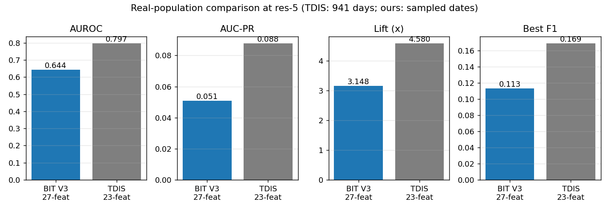
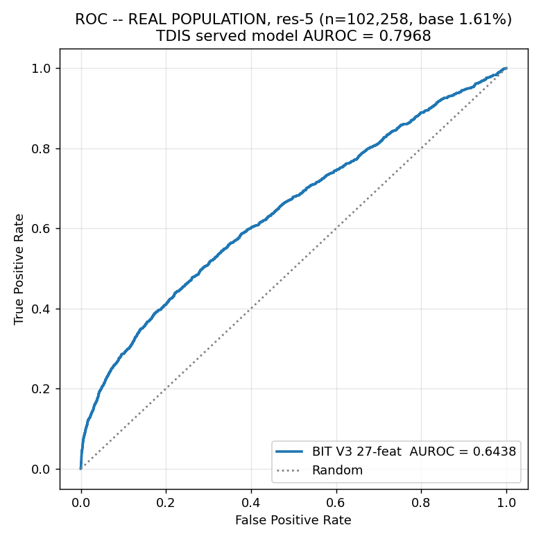
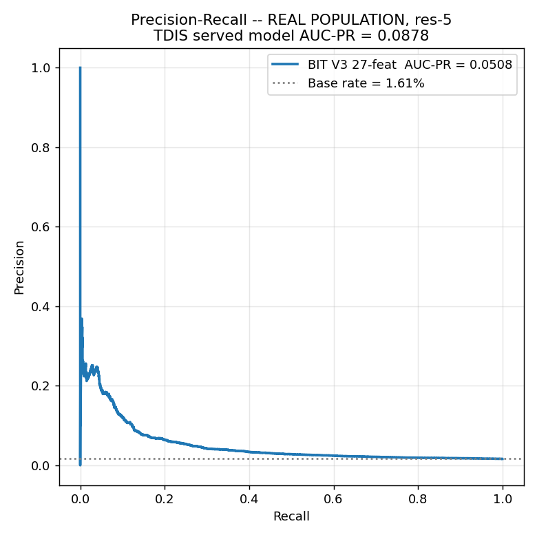
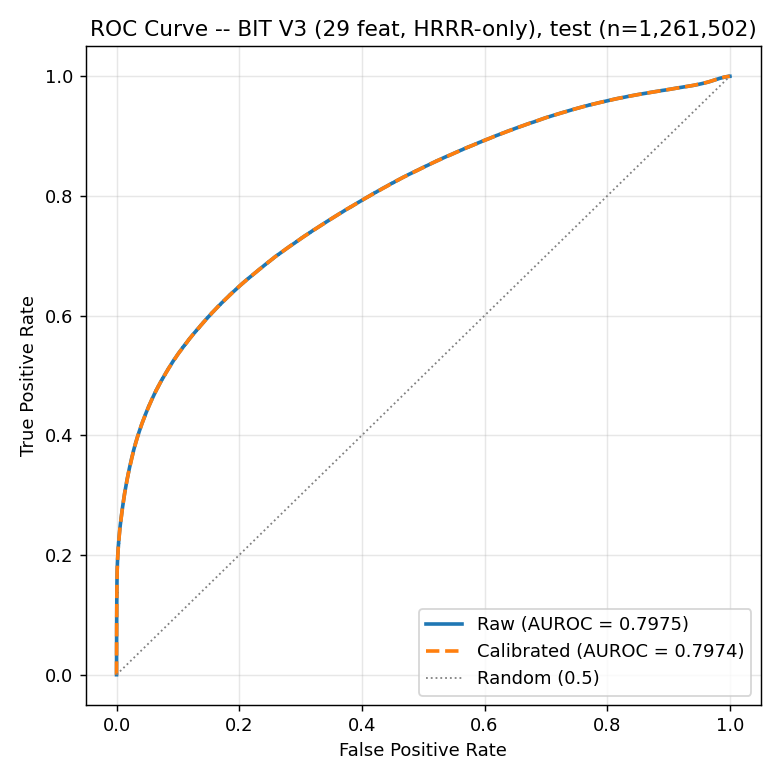
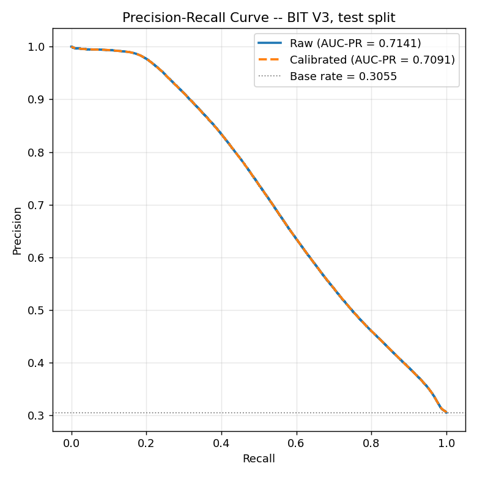
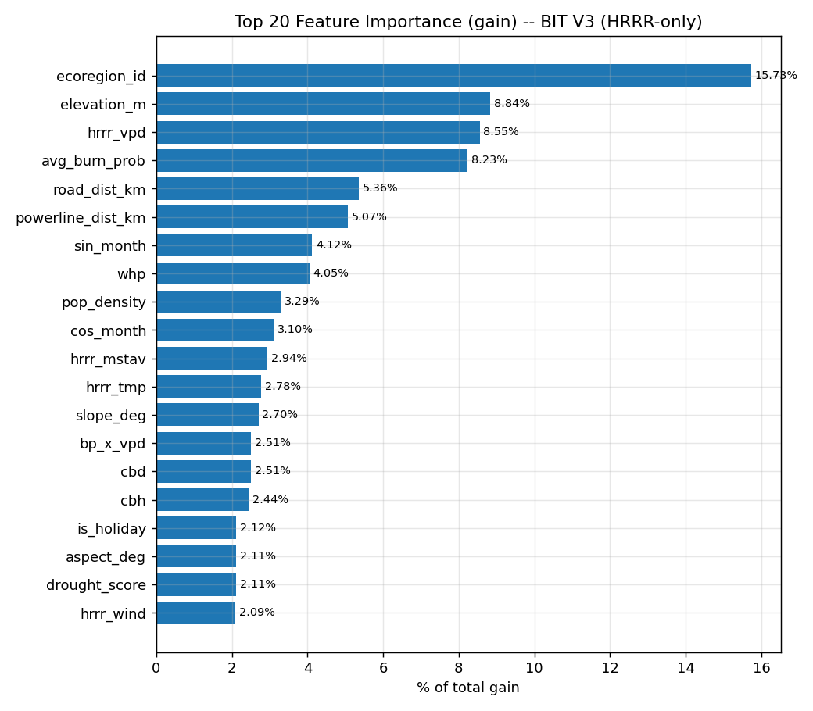

# Wildfire Ignition Model — Final Comparison Report
### TDIS (23 features) → BIT V2 (36 features) → BIT V3 Final (27 features)

**Date:** 2026-10-15 · **Location:** `TDIS_Ignition_BIT_V3/` · **Environment:** conda `torch_gpu`, xgboost 3.2.0, GPU (CUDA)

---

## 1. Summary

We built three generations of the Texas ignition model. Each step removed something on purpose:

| Stage | Model | Features | What changed |
|---|---|---|---|
| **1** | **TDIS served model** (Texas team) | **23** | Starting point. Static + calendar + HRRR forecast + drought. No lat/lon, no gridMET. |
| **2** | **BIT V2** (ours) | **36** | Added 8 gridMET weather columns, `fm100_5d_min`, `pop_density` and 3 interaction terms. No `lat`/`lon`. |
| **3** | **BIT V3 Final** (ours) | **27** | Removed **all gridMET** (same-day observed weather, not a forecast). No `lat`/`lon` (Texas team feedback). HRRR is the only weather source. |

**Headline result:** the final 27-feature model, built only from information available at forecast time, scores **AUROC 0.7975 / AUC-PR 0.7141 / F1 0.6179** on the 1.26 M-row test set. That is within **0.005 AUROC** of the 36-feature V2 model, which used gridMET. It is also well above the 23-feature TDIS model on the matched-sample metrics.

> **Real-population caveat.** On the real population (§6) the final model is clearly behind TDIS: res-5 AUROC 0.644 vs 0.797, lift 3.15× vs 4.58×.

> **Count note.** The final model has **27 features**, not 26. The training script asserts `len(FEATURES) == 27`, and `models/feature_list.json` and the dataset agree. Two of the 27 (`flep4`, `cfl`) have **0.00 % importance**, so **25 features do any work**.

---

## 2. Feature sets used

### 2.1 Side-by-side

| Group | TDIS (23) | BIT V2 (36) | **BIT V3 Final (27)** |
|---|---|---|---|
| Static terrain / fuel / infrastructure | `road_dist_km`, `ecoregion_id`, `elevation_m`, `slope_deg`, `aspect_deg`, `avg_burn_prob`, `whp`, `flep4`, `cfl`, `cbd`, `cbh`, `powerline_dist_km` (12) | same 12 + `pop_density` (13) | same 12 + `pop_density` (**13**) |
| Calendar | `sin_month`, `cos_month`, `sin_dow`, `cos_dow`, `is_weekend`, `is_holiday` (6) | same (6) | same (**6**) |
| HRRR forecast weather | `hrrr_tmp`, `hrrr_vpd`, `hrrr_wind`, `hrrr_mstav` (4) | same (4) | same (**4**) |
| Drought (USDM weekly) | `drought_score` (1) | `drought_score` (1) | `drought_score` (**1**) |
| Interactions | — | `bp_x_vpd`, `whp_x_vpd`, `bp_x_drought` (3) | same (**3**) |
| gridMET same-day weather | — | `erc`, `fm100`, `vpd`, `vs`, `rmax`, `rmin`, `tmmx`, `pr`, `fm100_5d_min` (**9**) | **removed (0)** |
| Raw coordinates | — | — (removed from BIT v1) | **none** |
| **Total** | **23** | **36** | **27** |

### 2.2 Why each change was made

| Change | Reason |
|---|---|
| gridMET removed (V2 → V3) | gridMET is **same-day observed** weather. It cannot be known when a forecast is issued, and this is a forecasting model. HRRR is true forecast data, so there should be one weather source (internal feedback, 2026-10-14). |
| `bp_x_vpd`, `whp_x_vpd` kept | Checked directly: correlation with the HRRR-based versions is r = 0.9999999, so they are built from `hrrr_vpd`, not gridMET `vpd`. |
| `lat`/`lon` removed | Texas team guidance not to use raw coordinates. They were first added in BIT v1 (38 features), dropped in V2, and stay out of V3. |
| `flep4`, `cfl` kept | Zero importance in every model. Kept only for schema compatibility with the TDIS feature order. |

### 2.3 The lineage in one line

```
TDIS 23  ──(+gridMET×9, +fm100_5d_min, +pop_density, +3 interactions, +lat/lon)──▶  BIT v1  38
BIT v1 38 ──(−lat, −lon)──▶ BIT V2  36 ──(−9 gridMET)──▶ BIT V3 Final  27
```

---

## 3. Metrics comparison

### 3.1 Main comparison table (test set)

| Metric | **TDIS 23** matched test | **TDIS 23** real population | **BIT V2 36** | **BIT V3 Final 27** | V3 vs V2 |
|---|:---:|:---:|:---:|:---:|:---:|
| **AUROC** | 0.7402 | 0.7968 | 0.8026 | **0.7975** | −0.0052 |
| **AUC-PR** | 0.4941 | 0.0878 | 0.7164 | **0.7141** | −0.0023 |
| **F1** | 0.4958 | 0.1692 | 0.6216 | **0.6179** | −0.0038 |
| **Precision** | 0.441 | 0.149 | 0.6105 | **0.6147** | +0.0042 |
| **Recall** | 0.566 | 0.185 | 0.6332 | **0.6210** | −0.0122 |
| **Lift** (vs base rate) | 2.11× | 4.58× | 2.34× | **2.34×** | ≈ 0 |
| Test rows | 891,983 | 5,064,462 | 1,261,502 | 1,261,502 | — |
| Base rate | 23.4 % | 1.92 % | 30.6 % | 30.6 % | — |
| Features | 23 | 23 | 36 | **27** | −9 |

> **How to read this table.** The "matched test" columns come from a rebalanced sample (fires over-represented, 23–31 % positive rate). AUC-PR, F1 and Precision depend on the base rate, so they are **not comparable** with the real-population column (1.92 %). TDIS's test set also differs from ours: they test on 2023–2026 with a 23.4 % base rate, and we test on 2022–2026-07 with 30.6 %. Treat TDIS-vs-BIT gaps as directional.

### 3.2 All four models, same format (our matched test set)

| Metric | BIT v1 – 38 feat (gridMET + lat/lon) | BIT V2 – 36 feat (gridMET, no lat/lon) | Interim V3 – 29 feat (no gridMET, **with** lat/lon) | **BIT V3 Final – 27 feat (no gridMET, no lat/lon)** |
|---|:---:|:---:|:---:|:---:|
| Test AUROC | **0.8064** | 0.8026 | 0.8046 | 0.7975 |
| Test AUC-PR | **0.7237** | 0.7164 | 0.7229 | 0.7141 |
| Test F1 | **0.6284** | 0.6216 | 0.6272 | 0.6179 |
| Test Lift | 2.37× | 2.34× | 2.37× | 2.34× |
| Train AUROC | 0.9494 | 0.9306 | 0.9376 | 0.9357 |
| **Train→Test AUROC gap** | 0.1430 | **0.1280** | 0.1330 | 0.1383 |
| Val AUC-PR | 0.7632 | 0.7493 | 0.7627 | 0.7475 |

The interim 29-feature model (superseded) is included because it separates the two removals:

| Step | AUROC change | AUC-PR change |
|---|---|---|
| Remove gridMET only (v1 38 → interim 29, lat/lon kept) | −0.0018 | −0.0008 |
| Remove lat/lon only (v1 38 → V2 36, gridMET kept) | −0.0038 | −0.0073 |
| Remove gridMET **and** lat/lon (v1 38 → **V3 Final 27**) | **−0.0090** | **−0.0097** |

Dropping gridMET is nearly free. Dropping lat/lon costs a little more, but the loss is still under 1 point of AUROC.

### 3.3 Calibration (isotonic, fit on validation only)

| | Raw | Calibrated |
|---|---|---|
| V3 Final – test AUROC | 0.7975 | 0.7974 |
| V3 Final – test AUC-PR | 0.7141 | 0.7091 |
| V3 Final – test Brier | 0.1582 | **0.1500** |
| V2 – test Brier | 0.1579 | 0.1493 |

Calibration is a monotone remap, so it leaves ranking unchanged and only corrects the probability scale.

### 3.4 Confusion matrices — test set, n = 1,261,502 (exact)

**BIT V3 Final, raw probability, best-F1 threshold = 0.4598**

|  | Predicted No Fire | Predicted Fire |
|---|---|---|
| **Actual No Fire** | TN = 726,094 | FP = 150,016 |
| **Actual Fire** | FN = 146,050 | TP = 239,342 |

Precision 0.6147 · Recall 0.6210 · Accuracy 0.7653

**BIT V3 Final, calibrated, best-F1 threshold = 0.3329:** TN 730,618 · FP 145,492 · FN 148,103 · TP 237,289 (Precision 0.6199, Recall 0.6157, Accuracy 0.7673)

**BIT V3 Final, raw, fixed threshold 0.5:** TN 757,617 · FP 118,493 · FN 161,451 · TP 223,941 (Precision 0.6540, Recall 0.5811, Accuracy 0.7781)

**Side-by-side at best-F1 (raw):**

| | TDIS 23 (matched, n = 891,983)* | BIT V2 36 | **BIT V3 Final 27** |
|---|---|---|---|
| TN | 533,414 | 720,388 | **726,094** |
| FP | 149,776 | 155,722 | **150,016** |
| FN | 90,616 | 141,348 | **146,050** |
| TP | 118,177 | 244,044 | **239,342** |
| Precision / Recall | 0.441 / 0.566 | 0.610 / 0.633 | **0.615 / 0.621** |

\*TDIS counts are derived from its published precision/recall, not computed directly.

---

## 4. Feature importance

XGBoost **gain**, as a share of total gain. TDIS shares were computed from the served model file (`tdis_forecast_hrrr_filtered.json`) with the same method. Rank is shown in brackets.

### 4.1 BIT V3 Final (27 features) vs BIT V2 and TDIS

| Rank (V3) | Feature | Group | **BIT V3 – 27 feat** | BIT V2 – 36 feat | TDIS – 23 feat |
|---|---|---|---|---|---|
| 1 | `ecoregion_id` | Static | **15.73% (#1)** | 14.73% (#1) | 14.07% (#1) |
| 2 | `elevation_m` | Static | **8.84% (#2)** | 8.52% (#2) | 10.20% (#2) |
| 3 | `hrrr_vpd` | HRRR forecast | **8.55% (#3)** | 7.42% (#3) | 5.98% (#4) |
| 4 | `avg_burn_prob` | Static | **8.23% (#4)** | 5.60% (#4) | 5.75% (#5) |
| 5 | `road_dist_km` | Static | **5.36% (#5)** | 4.39% (#5) | 4.84% (#8) |
| 6 | `powerline_dist_km` | Static | **5.07% (#6)** | 4.33% (#6) | 4.69% (#9) |
| 7 | `sin_month` | Calendar | **4.12% (#7)** | 3.29% (#8) | 7.25% (#3) |
| 8 | `whp` | Static | **4.05% (#8)** | 3.17% (#9) | 3.56% (#11) |
| 9 | `pop_density` | Static | **3.29% (#9)** | 2.58% (#11) | — |
| 10 | `cos_month` | Calendar | **3.10% (#10)** | 2.36% (#12) | 5.72% (#6) |
| 11 | `hrrr_mstav` | HRRR forecast | **2.94% (#11)** | 2.59% (#10) | 4.86% (#7) |
| 12 | `hrrr_tmp` | HRRR forecast | **2.78% (#12)** | 2.18% (#13) | 4.05% (#10) |
| 13 | `slope_deg` | Static | **2.70% (#13)** | 2.12% (#15) | 2.81% (#19) |
| 14 | `bp_x_vpd` | Interaction | **2.51% (#14)** | 2.15% (#14) | — |
| 15 | `cbd` | Static | **2.51% (#15)** | 1.90% (#18) | 3.03% (#16) |
| 16 | `cbh` | Static | **2.44% (#16)** | 2.05% (#17) | 2.93% (#17) |
| 17 | `is_holiday` | Calendar | **2.12% (#17)** | 1.83% (#19) | 3.46% (#12) |
| 18 | `aspect_deg` | Static | **2.11% (#18)** | 1.75% (#21) | 1.82% (#21) |
| 19 | `drought_score` | Drought (USDM) | **2.11% (#19)** | 1.61% (#24) | 3.43% (#13) |
| 20 | `hrrr_wind` | HRRR forecast | **2.09% (#20)** | 1.78% (#20) | 2.36% (#20) |
| 21 | `is_weekend` | Calendar | **1.99% (#21)** | 1.75% (#22) | 3.20% (#14) |
| 22 | `whp_x_vpd` | Interaction | **1.86% (#22)** | 1.37% (#31) | — |
| 23 | `bp_x_drought` | Interaction | **1.85% (#23)** | 1.53% (#27) | — |
| 24 | `sin_dow` | Calendar | **1.84% (#24)** | 1.44% (#28) | 3.07% (#15) |
| 25 | `cos_dow` | Calendar | **1.82% (#25)** | 1.39% (#29) | 2.90% (#18) |
| 26 | `flep4` | Static | **0.00% (#26)** | 0.00% (#35) | 0.00% (#22) |
| 27 | `cfl` | Static | **0.00% (#27)** | 0.00% (#36) | 0.00% (#23) |

### 4.2 Features that were in V2 and are gone in V3 (all gridMET)

| Feature | V2 importance | What replaced it |
|---|---|---|
| `rmin` | 4.25% (#7) | `hrrr_vpd`, `avg_burn_prob` |
| `rmax` | 2.08% (#16) | `hrrr_tmp` |
| `tmmx` | 1.73% (#23) | `hrrr_tmp` |
| `vpd` | 1.61% (#25) | `hrrr_vpd` |
| `fm100_5d_min` | 1.55% (#26) | `hrrr_mstav` |
| `fm100` | 1.38% (#30) | `hrrr_mstav` |
| `vs` | 1.27% (#32) | `hrrr_wind` |
| `erc` | 1.15% (#33) | `hrrr_vpd` |
| `pr` | 1.13% (#34) | `drought_score` |

Together the nine gridMET columns carried **16.2 %** of V2's gain. Their share was redistributed onto features that were already present, mainly `avg_burn_prob` (+2.6 pts), `hrrr_vpd` (+1.1) and `ecoregion_id` (+1.0). This is why accuracy barely moved. The "replacements" in the right-hand column are inferred from which features gained share, not tested directly.

### 4.3 Importance by feature group

| Group | TDIS 23 | BIT V2 36 | **BIT V3 Final 27** |
|---|---|---|---|
| Static (terrain, fuel, roads, population) | 53.7 % | 51.2 % | **60.3 %** |
| HRRR forecast weather | 17.3 % | 14.0 % | **16.4 %** |
| Calendar | 25.6 % | 12.1 % | **15.0 %** |
| Interactions | — | 5.1 % | **6.2 %** |
| Drought (USDM) | 3.4 % | 1.6 % | **2.1 %** |
| gridMET same-day weather | — | 16.2 % | **0 %** |

### 4.4 What the importance numbers say

1. **`ecoregion_id` is the #1 feature in all three models** (14–16 %). It is the strongest signal for *where* fires happen, and it is the one that grew once `lat`/`lon` were gone.
2. **Top 6 are the same in V2 and V3** (`ecoregion_id`, `elevation_m`, `hrrr_vpd`, `avg_burn_prob`, `road_dist_km`, `powerline_dist_km`). Together they carry 51.8 % of V3's gain.
3. **`hrrr_vpd` is the most important dynamic feature** in both our models. It is a true forecast variable, which supports the HRRR-only decision.
4. **`flep4` and `cfl` are dead (0.00 %) in all three models.** They can be dropped in a future cleanup with no accuracy loss, which would give a 25-feature model.
5. **Calendar features matter much more in TDIS** (25.6 % vs 15.0 % in V3). TDIS leans on `sin_month`/`cos_month` as a seasonal proxy. Our models get seasonality from `hrrr_vpd`, `drought_score` and the interaction terms.

---

## 5. Training details for the final model

| Item | Value |
|---|---|
| Source data | `TDIS_Ignition_BIT/data/bit_train_tx.parquet` with the 9 gridMET columns and `lat`/`lon` dropped |
| Rows | 2,201,289 (train 671,455 / val 268,332 / test 1,261,502) |
| Positive rate | train 30.42 % · val 28.76 % · test 30.55 % |
| Splits | Train 2018-07 → 2020-12 · Val 2021 · Test 2022 → 2026-07-29 |
| Search | 3 stages, 34 trials (depth × min_child_weight → lr × subsample → gamma × colsample). Stage 1 uses a regularization-aware pick: the most regularized option within 0.003 AUC-PR of the best. |
| Final hyperparameters | `max_depth 9`, `min_child_weight 50`, `learning_rate 0.05`, `subsample 0.9`, `colsample_bytree 0.8`, `gamma 0.1`, `scale_pos_weight 2.2872`, `early_stopping_rounds 80`, `best_iteration 970`, `device cuda`, `random_state 42` |
| Runtime | 273.9 s (34 trials + final model, GPU) |

---

## 6. Real-population validation (full Texas grid, real labels)

Matched-sample metrics (§3) use a rebalanced ~30 % positive set. This section scores the **final 27-feature model on every Texas grid cell** for 19 real dates, using **archived HRRR forecasts** (issued D-1 12Z, 24 h lead) and **real recorded ignitions** as labels.

| Item | Value |
|---|---|
| Dates | 19 (15 Jan/Apr/Jul/Oct, 2022-2026; 2026 only to Jul) |
| Cell-days scored | 32,460,151 (res-8, flare cells excluded) |
| True ignitions | 2,684 (base rate 0.008 %) |
| Res-5 aggregation (TDIS's convention) | 102,258 cell-days, 1,650 positives, base rate **1.61 %** |

### 6.1 Comparison table — res-5 (apples-to-apples with TDIS)

| Metric | **TDIS 23-feat** (served model, 941 days) | Interim 29-feat (gridMET removed, lat/lon kept; 19 days) | **BIT V3 Final 27-feat** (19 days) |
|---|:---:|:---:|:---:|
| Base rate | 1.92 % | 1.61 % | **1.61 %** |
| AUROC | **0.7968** | 0.6903 | **0.6438** |
| AUC-PR | **0.0878** | 0.0624 | **0.0508** |
| Lift | **4.58×** | 3.87× | **3.15×** |
| Best F1 | **0.1692** | 0.1319 | **0.1132** |
| Precision @ best F1 | **0.1493** | 0.1355 | **0.1086** |
| Recall @ best F1 | **0.1851** | 0.1285 | **0.1182** |

Confusion matrix, res-5, raw, best-F1 threshold 0.2539:

|  | Predicted No Fire | Predicted Fire |
|---|---|---|
| **Actual No Fire** | TN = 99,008 | FP = 1,600 |
| **Actual Fire** | FN = 1,455 | TP = 195 |

Calibrated: AUROC 0.6437, AUC-PR 0.0506, lift 3.13×.

### 6.2 Res-8, single-day granularity (raw)

| Metric | Interim 29-feat | **BIT V3 Final 27-feat** |
|---|:---:|:---:|
| AUROC | 0.6968 | **0.6532** |
| AUC-PR | 0.0004 | **0.0003** |
| Lift | 4.91× | **3.66×** |
| Brier raw → calibrated | 0.00749 → 0.00388 | 0.00672 → **0.00376** |

Confusion matrix (raw, best-F1 threshold 0.8104): TN 32,453,085 · FP 4,382 · FN 2,671 · TP 13.

Calibrated threshold sweep (res-8):

| Threshold | Precision | Recall | F1 | Cells flagged |
|---|---|---|---|---|
| 0.01 | 0.0001 | 0.865 | 0.0002 | 24.5 M |
| 0.05 | 0.0002 | 0.381 | 0.0004 | 5.3 M |
| 0.10 | 0.0004 | 0.196 | 0.0007 | 1.5 M |
| 0.20 | 0.0007 | 0.114 | 0.0013 | 465,134 |
| 0.50 | 0.0013 | 0.035 | 0.0026 | 71,498 |

AUC-PR is tiny at res-8 because the base rate is 0.008 %. It is mechanically bounded by the base rate, so use the res-5 table for comparison with TDIS.

### 6.3 What the real-population result says

1. **The final model trails the TDIS served model on every real-population metric.** At res-5: AUROC −0.153, AUC-PR −0.037, lift 3.15× vs 4.58×.
2. **Removing lat/lon hurt far more on the real population than on the matched sample.** Matched-sample AUROC fell 0.007 (0.8046 → 0.7975), but real-population res-5 AUROC fell 0.047 (0.6903 → 0.6438). Raw coordinates let the model place risk geographically across all 1.7 M cells, and that matters more once non-fire cells outnumber fires 10,000 to 1.
3. **Matched-sample accuracy overstates deployment skill.** Our matched AUROC (0.7975) is above TDIS's matched AUROC (0.7402), yet on the real population TDIS is clearly ahead. The matched sample is not the number to quote operationally.
4. **Calibration is fine.** Calibrated Brier is 0.00376, about half the raw 0.00672.

### 6.4 Real-population caveats

- **Only 19 dates**, one per season per year, against TDIS's 941 continuous days. Rare-event metrics are noisy on few days, so treat this as a first estimate. A continuous year would tighten it.
- The 29-feat vs 27-feat comparison uses the same 19 dates, so that gap is like-for-like. The comparison to TDIS is not: it uses different dates.
- TDIS numbers are the published figures (2024-2026 continuous, from `TDIS_Ignition/README.md`), not recomputed here.

### 6.5 Real-population images

**Folder:** `TDIS_Ignition_BIT_V3/realpop/results/figures/`

| # | File | What it shows |
|---|---|---|
| 1 | [`01_roc_curve_realpop.png`](realpop/results/figures/01_roc_curve_realpop.png) | ROC, res-8, 32.5 M cell-days |
| 2 | [`02_pr_curve_realpop.png`](realpop/results/figures/02_pr_curve_realpop.png) | Precision-recall, res-8 |
| 3 | [`03_confusion_matrix_realpop_raw.png`](realpop/results/figures/03_confusion_matrix_realpop_raw.png) | Confusion matrix, res-8, raw |
| 4 | [`04_confusion_matrix_realpop_calibrated.png`](realpop/results/figures/04_confusion_matrix_realpop_calibrated.png) | Confusion matrix, res-8, calibrated |
| 5 | [`05_reliability_realpop.png`](realpop/results/figures/05_reliability_realpop.png) | Reliability diagram, real population |
| 6 | [`06_prediction_distribution_realpop.png`](realpop/results/figures/06_prediction_distribution_realpop.png) | Score distribution by true label |
| 7 | [`07_roc_curve_res5.png`](realpop/results/figures/07_roc_curve_res5.png) | ROC, res-5 (TDIS convention) |
| 8 | [`08_pr_curve_res5.png`](realpop/results/figures/08_pr_curve_res5.png) | Precision-recall, res-5 |
| 9 | [`09_confusion_matrix_res5.png`](realpop/results/figures/09_confusion_matrix_res5.png) | Confusion matrix, res-5 |
| 10 | [`10_comparison_vs_tdis_res5.png`](realpop/results/figures/10_comparison_vs_tdis_res5.png) | Bar chart: BIT V3 vs TDIS on AUROC, AUC-PR, lift, F1 |





---

## 7. Output images — matched test set, final 27-feature model

**Folder:** `TDIS_Ignition_BIT_V3/results/figures/`
Generated by `scripts/generate_visuals.py` on the real test split (n = 1,261,502).

| # | File | What it shows |
|---|---|---|
| 1 | [`01_roc_curve.png`](results/figures/01_roc_curve.png) | ROC curve, raw and calibrated (AUROC 0.7975) |
| 2 | [`02_pr_curve.png`](results/figures/02_pr_curve.png) | Precision–recall curve vs the 30.55 % base rate (AUC-PR 0.7141) |
| 3 | [`03_confusion_matrix_raw.png`](results/figures/03_confusion_matrix_raw.png) | Confusion matrix, raw probability, best-F1 threshold |
| 4 | [`04_confusion_matrix_calibrated.png`](results/figures/04_confusion_matrix_calibrated.png) | Confusion matrix, calibrated probability |
| 5 | [`05_precision_recall_f1_vs_threshold.png`](results/figures/05_precision_recall_f1_vs_threshold.png) | Precision, recall and F1 across all thresholds |
| 6 | [`06_feature_importance.png`](results/figures/06_feature_importance.png) | Feature importance (gain) |
| 7 | [`07_calibration_reliability.png`](results/figures/07_calibration_reliability.png) | Reliability diagram, raw vs calibrated |
| 8 | [`08_prediction_distribution.png`](results/figures/08_prediction_distribution.png) | Score distribution by true label |
| 9 | [`09_calibration_curve_map.png`](results/figures/09_calibration_curve_map.png) | Isotonic calibrator mapping curve |





Other artifacts in this folder:

| Path | Content |
|---|---|
| `models/model_bit_v3_27feat.json` | Trained XGBoost booster (19 MB, git-ignored) |
| `models/calibrator_bit_v3_27feat.joblib` | Isotonic calibrator (git-ignored) |
| `models/feature_list.json` | The exact 27 features in training order |
| `results/training_results_bit_v3_27feat.json` | All metrics, confusion matrices, importances, hyperparameters |
| `results/tuning_stage{1,2,3}.csv` | Every hyperparameter trial |

---

## 8. Caveats

1. **Real-population skill is the weak point.** On 19 sampled dates the final model reaches res-5 AUROC 0.644 and lift 3.15×, against TDIS's 0.797 and 4.58× (§6). The matched-sample table in §3 does not show this gap.
2. **TDIS vs BIT on matched-test metrics are directional.** The test windows and base rates differ (§3.1). The only like-for-like metric across base rates is **lift**: 2.11× (TDIS) vs 2.34× (ours) on matched samples.
3. **Overfitting gap is 0.138** (train 0.936 → test 0.797). It is larger than V2's 0.128. Tree depth 9 is the main driver, which V2's analysis already showed.
4. **Dropping lat/lon cost about 0.004–0.007 AUROC (0.0038 with gridMET present, 0.0071 without).** This is small, and consistent with the Texas team's preference for not using raw coordinates, but it is a real, measurable cost.
5. **Feature count.** The final model has 27 features (25 with non-zero importance), not 26.

---

## 9. Reproduce

```bash
cd TDIS_Ignition_BIT_V3
PY=/c/Users/Admin/anaconda3/envs/torch_gpu/python.exe
$PY scripts/build_dataset.py        # 27-feature dataset (drops gridMET + lat/lon)
$PY scripts/tune_train_model.py     # 3-stage search + final model + calibrator
$PY scripts/generate_visuals.py     # 9 figures -> results/figures/
# Real-population (needs eccodes on PATH for Herbie)
PATH="/c/Users/Admin/anaconda3/envs/torch_gpu/Library/bin:$PATH" $PY realpop/scripts/01_pull_score_days.py
$PY realpop/scripts/02_evaluate_realpop.py   # res-8 metrics + figures 01-06
$PY realpop/scripts/03_evaluate_res5.py      # res-5 metrics + figures 07-10
```

> `BIT_V3_TRAINING_REPORT.md` in this folder describes the earlier **29-feature** interim build (gridMET removed, lat/lon kept) and the real-population run. It is superseded by this report for the final model.
